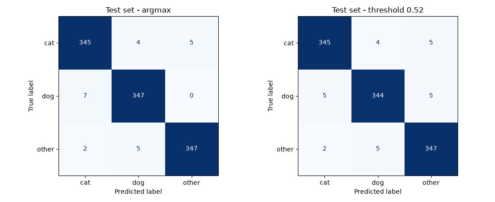
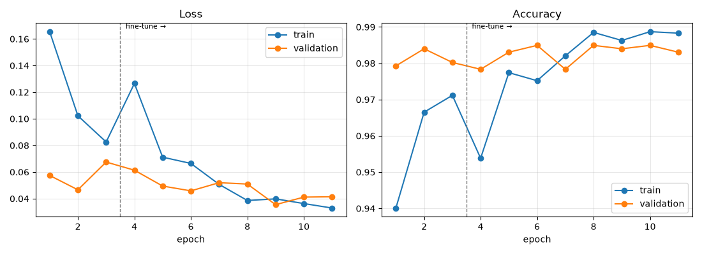

# Evaluation report - model v1.0.0

Model: MobileNetV3-Small (ImageNet pretrained), fine-tuned for ['cat', 'dog', 'other'].
Best checkpoint: epoch 6 (validation accuracy 0.9849).
Test set: 1062 untouched images (balanced).

## Test results with confidence threshold 0.52
(threshold tuned on the validation set; low-confidence answers become "other")

**Accuracy: 0.9755**

| class | precision | recall | F1 | images |
|---|---|---|---|---|
| cat | 0.9801 | 0.9746 | 0.9773 | 354 |
| dog | 0.9745 | 0.9718 | 0.9731 | 354 |
| other | 0.9720 | 0.9802 | 0.9761 | 354 |
| **macro avg** | 0.9755 | 0.9755 | 0.9755 | |

## Test results without threshold (plain argmax)

**Accuracy: 0.9783**

| class | precision | recall | F1 | images |
|---|---|---|---|---|
| cat | 0.9746 | 0.9746 | 0.9746 | 354 |
| dog | 0.9747 | 0.9802 | 0.9775 | 354 |
| other | 0.9858 | 0.9802 | 0.9830 | 354 |
| **macro avg** | 0.9784 | 0.9783 | 0.9783 | |

## Plots

